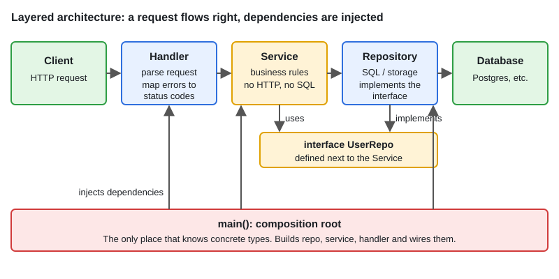

# Idiomatic Go Architecture Patterns

[← Section index](../README.md) · Prev: [04 · Behavioral Patterns in Go](../04-behavioral-patterns/README.md) · Next: [LLD: Parking Lot](../06-lld-parking-lot/README.md)

**Interview weight: 1.0%**  ·  Revise in: 8 min  ·  Run: `go run ./06-lld-design-patterns/05-idiomatic-go-architecture-patterns`

## In one line
Keep handler, service and repository separate, define interfaces at the consumer, and wire everything by hand in `main()`.

## Must know
- **Handler**: HTTP only (decode, call service, map errors to status codes). No business rules.
- **Service**: business rules. Knows nothing about HTTP or SQL.
- **Repository**: storage behind an interface (`FindByID`). Swap Postgres for an in-memory fake in tests.
- **Composition root**: `main()` builds concrete types and injects them. No DI framework needed.
- **Hexagonal (ports and adapters)**: the domain defines ports (interfaces), adapters (HTTP, DB) implement them.
- Domain errors (`ErrNotFound`) are mapped to status codes in the handler using `errors.Is`.
- Pass `context.Context` as the first parameter through all layers.
- Suggested layout: `cmd/app/main.go`, `internal/service`, `internal/repo`, `internal/http`.

## Diagram


## Code to remember
```go
type UserRepo interface{ FindByID(id int) (*User, error) } // owned by the service

type UserService struct{ repo UserRepo }

func NewUserService(r UserRepo) *UserService { return &UserService{repo: r} }

// main(): svc := NewUserService(pgRepo); mux.Handle("GET /users/{id}", NewHandler(svc))
```

## Common traps
- Business logic in handlers, which makes it untestable without HTTP.
- Leaking storage types (SQL rows, ORM models) up into handlers and JSON responses.
- Package cycles from putting interfaces in the implementer's package. Declare them with the consumer.
- Global `db` variables instead of injected dependencies.

## Interview Q&A

**Q1. How do you unit test the service layer?**

**A:** Pass a fake `UserRepo` (a map-backed struct). No database and no HTTP, so tests are fast and deterministic.

**Q2. How do you inject dependencies without a framework?**

**A:** Constructors accept interfaces, `main()` wires them. No reflection or magic.

**Q3. Why a repository interface?**

**A:** It decouples business logic from storage and lets tests use an in-memory fake.

**Q4. Where do you map errors to HTTP status codes?**

**A:** In the handler. Services return domain errors and the handler translates them (404 for not found, 400 for invalid input).

**Q5. Layered vs hexagonal?**

**A:** Layered: handler to service to repo, each calling the next. Hexagonal: the domain owns the interfaces (ports) and HTTP or DB code (adapters) depends on them, so dependencies point inward.

**Q6. What does the `internal/` directory do?**

**A:** The compiler stops code outside the parent module tree from importing it. Your service and repo packages stay private to the app.
