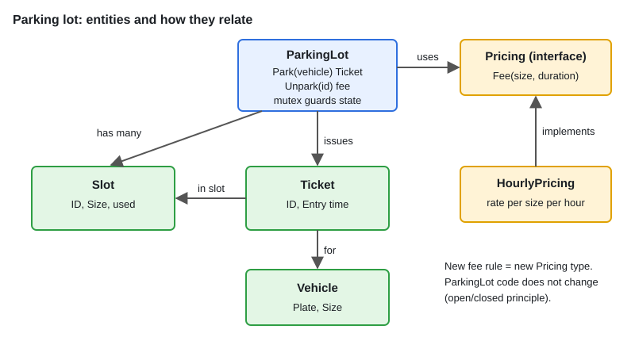

# LLD: Parking Lot

[← Section index](../README.md) · Prev: [Idiomatic Go Architecture Patterns](../05-idiomatic-go-architecture-patterns/README.md) · Next: [07 · LLD: Rule Engine](../07-lld-rule-engine/README.md)

**Interview weight: 1.1%**  ·  Revise in: 10 min  ·  Run: `go run ./06-lld-design-patterns/06-lld-parking-lot`

## In one line
Model Vehicle, Slot, Ticket and ParkingLot, make pricing a swappable strategy, and protect the lot's state with a mutex.

## Must know
- **Clarify first**: vehicle types, number of floors, pricing rule, one entry or many, capacity behaviour (reject when full).
- **Entities**: `Vehicle`, `Slot` (size, used), `Ticket` (id, slot, entry time), `ParkingLot`.
- **Operations**: `Park(vehicle) (Ticket, error)` and `Unpark(ticketID) (fee, error)`.
- **Slot choice**: first free slot that fits. Keeping slots ordered small to large gives smallest-fit.
- **Pricing** is an interface (`Fee(size, duration)`), so a new rule does not change the lot (open/closed).
- **Concurrency**: many gates call `Park` at once, so one `sync.Mutex` around the slot scan and ticket map.
- **Testability**: inject the clock (`now func() time.Time`) so fees are deterministic.
- Errors: lot full, unknown ticket, double unpark.

## Diagram


## Code to remember
```go
type Pricing interface{ Fee(size Size, d time.Duration) float64 }

func (l *Lot) Park(v Vehicle) (*Ticket, error) {
	l.mu.Lock()
	defer l.mu.Unlock()
	for _, s := range l.slots {
		if !s.used && s.Size >= v.Size { /* mark used, issue ticket */ }
	}
	return nil, ErrFull
}
```

## Common traps
- Scanning all slots on every `Park`. Fine for an interview, but say you would keep a free list per size for O(1).
- Calling `time.Now()` inside the fee logic, which makes it untestable.
- Releasing a slot without deleting the ticket, so a second `Unpark` charges again.
- Hard-coding fee rules inside `Unpark` instead of a pricing strategy.

## Interview Q&A

**Q1. How do you find the nearest free slot fast?**

**A:** Keep a min-heap or sorted free list per slot size (and floor). Pop to park, push back to unpark. O(log n) or O(1).

**Q2. How do you add a new vehicle type or fee rule?**

**A:** A new size constant and a new `Pricing` implementation. The lot logic is unchanged.

**Q3. How do you handle concurrent entries?**

**A:** A mutex around allocation. For scale, shard by floor with a lock per floor.

**Q4. How would you support multiple floors?**

**A:** A `Floor` type owning its slots, and the lot iterates floors (or picks the floor with a free slot of the right size).
