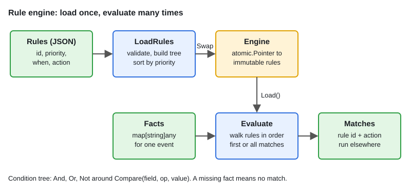

# 07 · LLD: Rule Engine

[← Section index](../README.md) · Prev: [LLD: Parking Lot](../06-lld-parking-lot/README.md) · Next: [LLD: In-Memory KV Store with TTL](../08-lld-in-memory-kv-store-with-ttl/README.md)

**Interview weight: 0.8%**  ·  Revise in: 10 min  ·  Run: `go run ./06-lld-design-patterns/07-lld-rule-engine`

## In one line
A rule engine separates policy (rules as data) from mechanism (code): load rules, evaluate them against facts, return the actions.

## Must know
- **Condition** is an interface with `Eval(Facts) bool`. Leaf `Compare` (field, op, value), composites `And`, `Or`, `Not`.
- **Rule** = id + priority + condition + action. Sorted by priority, highest first.
- **Facts** are a `map[string]any` for one event. A missing field means no match, never a panic.
- **Match mode**: first-match (one outcome, precedence) or all-match (audit, every violation).
- **Validate at load time**: unknown operators fail `LoadRules`, so `Evaluate` can trust the rules.
- **Hot reload**: keep rules immutable behind `atomic.Pointer`. Build a new set, then `Store`. Readers take no lock.
- Return actions as data and let another component execute them. The engine stays pure and testable.
- Adding an operator is one new case. Adding a combinator is one new type.

## Diagram


## Code to remember
```go
type Condition interface{ Eval(Facts) bool }

type And []Condition

func (a And) Eval(f Facts) bool {
	for _, c := range a {
		if !c.Eval(f) {
			return false
		}
	}
	return true
}
```

## Common traps
- Type-switching on condition kinds inside the engine instead of using the interface.
- Mutating a rule slice that readers are using. Always swap in a whole new immutable set.
- Comparing values with `fmt.Sprint` in real systems. It is lossy; use typed comparators. The demo does it to stay short.
- JSON numbers decode to `float64`. Compare numbers as `float64` or convert deliberately.

## Interview Q&A

**Q1. Why an interface for conditions?**

**A:** New operators or combinators are new types, and the evaluation loop never changes (open/closed).

**Q2. First-match vs all-match?**

**A:** First-match for precedence such as pricing tiers. All-match for compliance, where every violation matters.

**Q3. How do you reload rules safely?**

**A:** Parse and validate the new set fully, then `atomic.Pointer.Store`. In-flight evaluations keep the old set.

**Q4. How do you scale to thousands of rules?**

**A:** Index rules by the fields they use, compile conditions to closures once at load, and short-circuit `And` and `Or`.

**Q5. How do you test it?**

**A:** Table tests of (facts, expected rule ids), plus a test that every shipped rule file loads without error.
