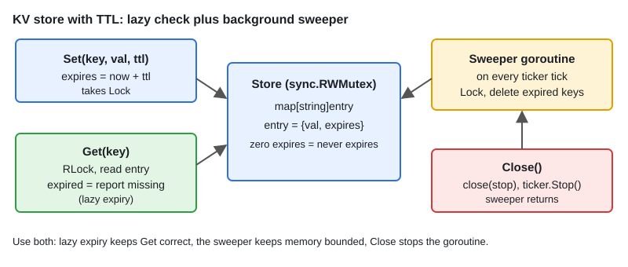

# LLD: In-Memory KV Store with TTL

[← Section index](../README.md) · Prev: [07 · LLD: Rule Engine](../07-lld-rule-engine/README.md) · Next: [LLD: State Machines — Vending Machine](../09-lld-state-machines-vending-machine-elevator/README.md)

**Interview weight: 0.9%**  ·  Revise in: 8 min  ·  Run: `go run ./06-lld-design-patterns/08-lld-in-memory-kv-store-with-ttl`

## In one line
A map guarded by `sync.RWMutex`, each entry carrying an expiry time, with lazy expiry on `Get` plus a background sweeper.

## Must know
- **API**: `Set(key, val, ttl)`, `Get(key) (val, ok)`, `Delete(key)`.
- **Entry** stores the value and an `expires` time. A zero time means no expiry.
- **Lazy expiry**: `Get` treats an expired entry as missing. Expired keys stay in memory.
- **Active expiry**: a goroutine on a `time.Ticker` deletes expired keys. Bounds memory.
- Use both: lazy for correctness, sweeper for memory.
- `RWMutex`: many concurrent readers, one writer. Use `Lock` in `Set`, `Delete` and the sweep.
- The sweeper needs a stop signal (`close(stop)` or context) from `Close`, or it leaks.
- Inject a clock if you want to test expiry without sleeping.

## Diagram


## Code to remember
```go
func (s *Store) Get(key string) (any, bool) {
	s.mu.RLock()
	e, ok := s.data[key]
	s.mu.RUnlock()
	if !ok || (!e.expires.IsZero() && time.Now().After(e.expires)) {
		return nil, false
	}
	return e.val, true
}
```

## Common traps
- Returning expired values because only the sweeper enforces TTL. `Get` must check too.
- Deleting inside `Get` while holding only `RLock`. Writing under a read lock is a data race.
- Forgetting `ticker.Stop()` and a stop channel, so the sweeper goroutine never exits.
- Sweeping the whole map under one long lock. Fine here, but mention batching or sharding for big stores.

## Interview Q&A

**Q1. Lazy vs active expiry?**

**A:** Lazy checks on access: simple, no background work, but dead keys linger. Active sweeps periodically: bounded memory, extra CPU.

**Q2. How does Redis expire keys?**

**A:** Both ways: lazily when a key is accessed, and an active process that samples keys with a TTL. I would not quote exact intervals.

**Q3. The sweeper scans every key under one lock. How do you improve it?**

**A:** Keep a min-heap of (expiry, key) and pop only what is due, or shard the map so each sweep locks one shard. Skip stale heap items when a key was overwritten.

**Q4. How do you make the store faster under high concurrency?**

**A:** Shard the map into N buckets with one lock each (hash the key), or use `sync.Map` for read-heavy workloads.

**Q5. How would you add LRU eviction?**

**A:** Add a doubly linked list plus the map, move entries to the front on access, and evict from the back at capacity.

**Q6. How do you stop the sweeper cleanly?**

**A:** `Close` does `close(s.stop)`, the sweeper loop selects on `stop` and returns, with `defer ticker.Stop()`. Guard `Close` with `sync.Once` so a second call does not panic.
