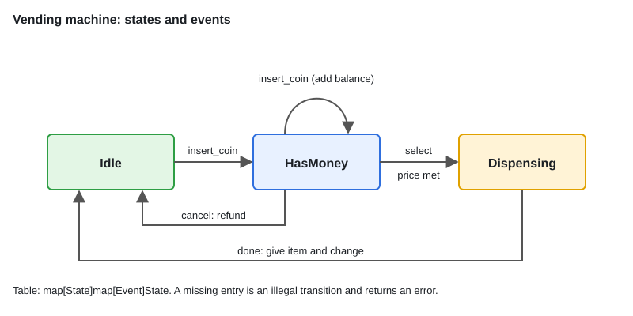

# LLD: State Machines — Vending Machine

[← Section index](../README.md) · Prev: [LLD: In-Memory KV Store with TTL](../08-lld-in-memory-kv-store-with-ttl/README.md) · Next: [LLD Interview Approach & Checklist](../10-lld-interview-approach-and-checklist/README.md)

**Interview weight: 0.7%**  ·  Revise in: 6 min  ·  Run: `go run ./06-lld-design-patterns/09-lld-state-machines-vending-machine-elevator`

## In one line
List the states and events, put the legal transitions in a table, and reject anything not in it.

## Must know
- **States**: Idle, HasMoney, Dispensing. **Events**: insert_coin, select, cancel, done.
- **Transition table**: `map[State]map[Event]State`. One place to read and test all rules.
- **Guards**: some transitions depend on data (`select` needs balance >= price). Return an error and stay in the same state.
- **Actions** run on a transition: refund on cancel, give item and change on done.
- Use a `switch` for tiny machines, the table for medium ones, state objects when each state has real behaviour.
- The elevator problem uses the same idea: states Idle, MovingUp, MovingDown, DoorsOpen, plus a request queue.
- For concurrent callers wrap `Handle` in a mutex.

## Diagram


## Code to remember
```go
var transitions = map[State]map[Event]State{
	Idle:     {InsertCoin: HasMoney},
	HasMoney: {InsertCoin: HasMoney, Select: Dispense, Cancel: Idle},
	Dispense: {Done: Idle},
}

to, ok := transitions[m.state][e]
if !ok { return fmt.Errorf("%s not allowed in %s", e, m.state) }
```

## Common traps
- Changing state before the guard passes, so a failed `select` leaves the machine in the wrong state.
- Forgetting to reset the balance on cancel or done, leaking money into the next customer.
- Reading `transitions[state][event]` and ignoring the `ok`. A zero-value state looks valid.
- Scattering state checks across many methods instead of one `Handle`.

## Interview Q&A

**Q1. State pattern vs a switch statement?**

**A:** Switch or table is fine when transitions are the logic. State objects pay off when every state has its own behaviour.

**Q2. How do you add a new state?**

**A:** Add a constant and its row in the table, plus any action. Existing states stay as they are.

**Q3. How do you support many products with stock?**

**A:** An `inventory map[code]struct{price, qty int}`. `select` is guarded: unknown code or qty 0 returns an error and stays in the same state. Decrement qty only when dispensing.

**Q4. How do you keep it thread-safe?**

**A:** Serialise events through one mutex, or send events over a channel to a single goroutine that owns the machine.

**Q5. How would you model an elevator?**

**A:** Same table: states and events, a queue of floor requests, and a rule for the next direction. Say you would keep the dispatch policy as a strategy.
