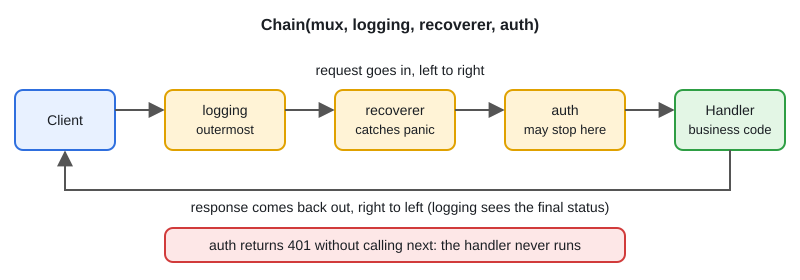
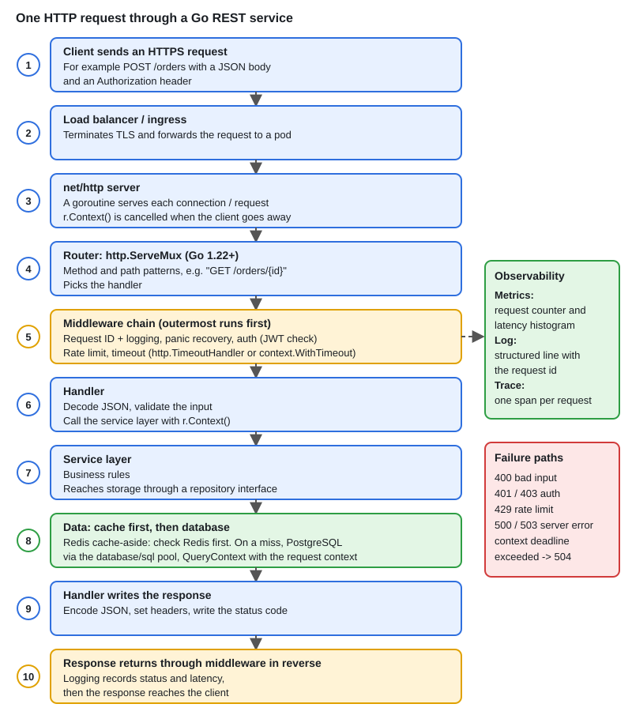

# 01 · REST API in Go: net/http & Middleware

[← Section index](../README.md) · Next: [02 · gRPC, Protobuf, Streaming & Interceptors](../02-grpc-protobuf-streaming-interceptors/README.md)

**Interview weight: 1.2%**  ·  Revise in: 10 min  ·  Run: `go run ./07-backend-ecosystem/01-rest-api-in-go-net-http-middleware`

## In one line
A Go REST service is `net/http` plus middleware (`func(http.Handler) http.Handler`), explicit server timeouts and graceful shutdown.

## Must know
- Go 1.22+ `ServeMux` routes by method and wildcard: `mux.HandleFunc("GET /items/{id}", h)`, read with `r.PathValue("id")`.
- Wrong method on a known path gives 405 automatically.
- Middleware wraps a handler. The first one listed is the outermost, so order matters (recover and log outside, auth inside).
- A middleware can short-circuit: write the response and `return` without calling `next`.
- `http.ListenAndServe` sets no timeouts. Use `http.Server` with `ReadHeaderTimeout`, `ReadTimeout`, `WriteTimeout`, `IdleTimeout`.
- Decode safely: `http.MaxBytesReader` plus `DisallowUnknownFields`. Return 400 for bad input.
- Status codes: 200, 201 create, 204 no body, 400 bad input, 401 not authenticated, 403 not allowed, 404, 409 conflict, 429, 500.
- Use `r.Context()` for downstream calls so work stops when the client disconnects.

## Diagram


## End-to-end


## Code to remember
```go
type Middleware func(http.Handler) http.Handler

func Chain(h http.Handler, mws ...Middleware) http.Handler {
	for i := len(mws) - 1; i >= 0; i-- {
		h = mws[i](h) // wrap from the inside out
	}
	return h
}

srv := &http.Server{Addr: ":8080", Handler: Chain(mux, logging, recoverer, auth),
	ReadHeaderTimeout: 5 * time.Second, IdleTimeout: 60 * time.Second}
// shutdown: srv.Shutdown(ctx) lets in-flight requests finish
```

## Common traps
- No server timeouts: slow clients hold connections forever.
- Forgetting `return` after `http.Error`, so the handler keeps running and writes twice.
- `WriteHeader` after the first `Write` is ignored (status is already 200).
- `http.DefaultClient` has no timeout, and a client response body must always be closed.
- A recover middleware does not catch panics in goroutines the handler starts.

## Interview Q&A

**Q1. How do you write middleware in Go?**

**A:** A function that takes an `http.Handler` and returns one. It does work before and/or after `next.ServeHTTP`, or returns early.

**Q2. 401 or 403?**

**A:** 401 means we do not know who you are (missing or bad credentials). 403 means we know you, but you are not allowed.

**Q3. How do you shut an HTTP server down gracefully?**

**A:** Catch SIGTERM with `signal.NotifyContext`, call `srv.Shutdown(ctx)` with a timeout. It stops accepting new connections and waits for active requests.

**Q4. Which HTTP methods are idempotent?**

**A:** GET, PUT, DELETE (and HEAD, OPTIONS). POST is not, so use an idempotency key for retried payments or orders.

**Q5. Do you need a router library like chi or gin?**

**A:** Since Go 1.22 the stdlib mux covers method and path wildcards. Libraries add convenience (groups, binding), not necessity.
