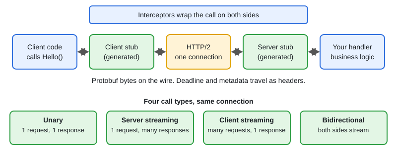

# 02 · gRPC, Protobuf, Streaming & Interceptors

[← Section index](../README.md) · Prev: [01 · REST API in Go: net/http & Middleware](../01-rest-api-in-go-net-http-middleware/README.md) · Next: [03 · PostgreSQL for Go Developers](../03-postgresql-for-go-developers/README.md)

**Interview weight: 1.1%**  ·  Revise in: 8 min  ·  Run: `go run ./07-backend-ecosystem/02-grpc-protobuf-streaming-interceptors`

## In one line
gRPC is RPC (call a remote function like a local one) over HTTP/2 with protobuf (a compact binary message format): a typed contract in a `.proto` file, generated Go code, deadlines, streaming and interceptors.

## Must know
- Contract first: write `.proto`, generate Go code (`protoc` with `protoc-gen-go` and `protoc-gen-go-grpc`).
- Four call types: unary, server streaming, client streaming, bidirectional (see diagram).
- Protobuf is binary and compact. Each field has a number; the number is its identity on the wire, not the name.
- Never reuse or renumber a field. Adding a new field is backward compatible. Mark removed ones `reserved`.
- proto3 has no "missing" for scalars: a zero value (0, "", false) looks the same as unset. Use wrapper or `optional` when it matters.
- Deadlines travel with the call and propagate through `context`. Always set one on the client.
- Errors are `status.Error(codes.NotFound, "...")`. Know `InvalidArgument`, `NotFound`, `Unauthenticated`, `PermissionDenied`, `DeadlineExceeded`, `Unavailable`.
- Interceptors are gRPC middleware (unary and stream) for logging, auth, metrics, recovery. Metadata = headers.

## Diagram


## Code to remember
```go
// requires google.golang.org/grpc
func logging(ctx context.Context, req any, info *grpc.UnaryServerInfo,
	next grpc.UnaryHandler) (any, error) {
	resp, err := next(ctx, req) // call the real handler
	log.Println(info.FullMethod, err)
	return resp, err
}

s := grpc.NewServer(grpc.ChainUnaryInterceptor(logging, auth))
```

## Common traps
- No client deadline: a slow server hangs the caller forever.
- gRPC connections are long-lived HTTP/2, so a plain L4 load balancer pins all calls to one pod. Use client-side balancing or an L7 proxy.
- Returning plain `errors.New` gives the client code `Unknown`. Return a `status` error.
- Reusing a field number after deleting a field corrupts old clients.

## Interview Q&A

**Q1. gRPC or REST for internal service calls?**

**A:** gRPC for internal service-to-service calls: typed contract, small binary protobuf payloads (numeric field tags, no field names), streaming, deadlines. REST for public APIs and browsers.

**Q2. What are the four gRPC call types?**

**A:** Unary (1 request, 1 response), server streaming (1 request, many responses, e.g. a feed), client streaming (many requests, 1 response, e.g. upload), bidirectional (both stream, e.g. chat).

**Q3. How do you evolve a proto without breaking clients?**

**A:** Only add new fields with new numbers. Never change a number or type. Reserve removed numbers.

**Q4. What is an interceptor?**

**A:** A wrapper around the RPC handler, like HTTP middleware. It can read metadata, reject the call, log, and record metrics.

**Q5. How does a deadline work across services?**

**A:** The client sets a timeout in the context, gRPC sends it to the server, and the server passes the same context on, so the whole chain stops when time is up.

**Q6. Why does gRPC need special load balancing in Kubernetes?**

**A:** Calls reuse one long-lived HTTP/2 connection, so an L4 balancer or ClusterIP sends them all to one pod. Use client-side balancing (headless Service) or an L7 proxy such as Envoy or Istio.
