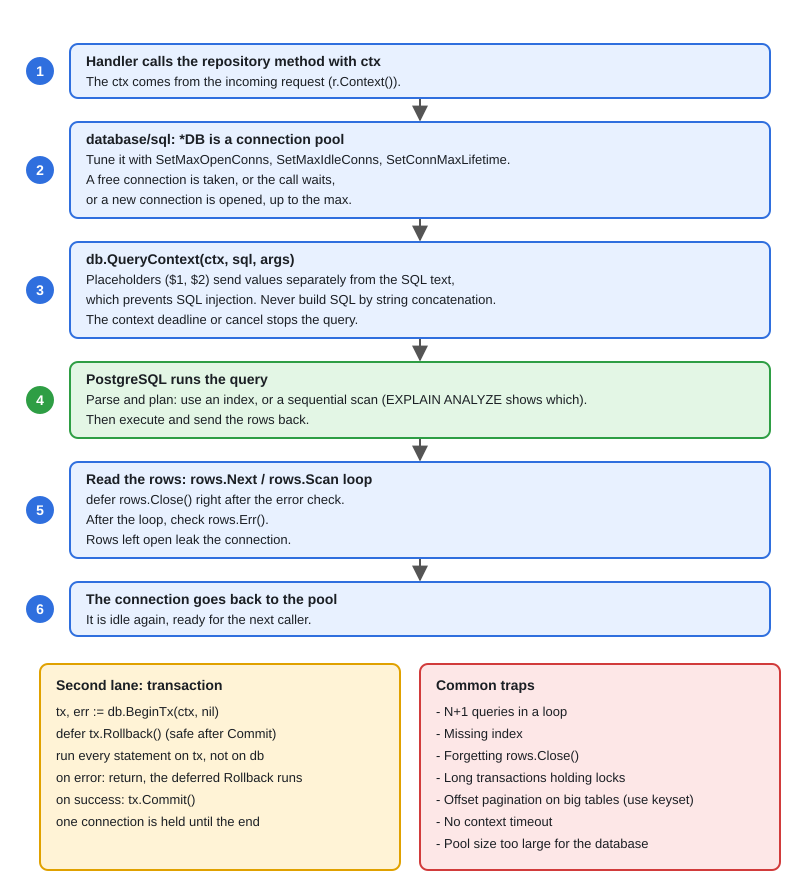

# 03 · PostgreSQL for Go Developers

[← Section index](../README.md) · Prev: [02 · gRPC, Protobuf, Streaming & Interceptors](../02-grpc-protobuf-streaming-interceptors/README.md) · Next: [04 · Redis Patterns](../04-redis-patterns/README.md)

**Interview weight: 1.2%**  ·  Revise in: 10 min  ·  Run: `go run ./07-backend-ecosystem/03-postgresql-for-go-developers`

## In one line
Use parameterized queries with a context, keep transactions short and owned by one helper, and index for the queries you actually run.

## Must know
- `database/sql` is a connection pool plus a driver (`pgx` stdlib driver or `lib/pq`). `pgx` and `pgxpool` also work directly.
- Always parameterize (`WHERE id = $1`), never concatenate SQL. Use the `...Context` methods so queries cancel with the request.
- Pool tuning: `SetMaxOpenConns`, `SetMaxIdleConns`, `SetConnMaxLifetime`. Too many connections hurts Postgres.
- `rows.Close()` returns the connection to the pool. Check `rows.Err()` after the loop. No row gives `sql.ErrNoRows`.
- Transactions: `BeginTx`, then `Commit` or `Rollback`. Default isolation is Read Committed. At stricter levels, retry on serialization failure (`40001`) and deadlock (`40P01`). Keep them short: they hold locks and a connection.
- Indexes are B-tree by default. A composite index `(a, b)` helps filters on `a` or on `a` and `b`, not on `b` alone.
- Check plans with `EXPLAIN ANALYZE`. A function on the column (`lower(email)`) skips a plain index.
- Upsert: `INSERT ... ON CONFLICT (email) DO UPDATE SET ...`. Row lock: `SELECT ... FOR UPDATE`.

## End-to-end


## Code to remember
```go
// database/sql with a Postgres driver (for example requires github.com/jackc/pgx/v5)
rows, err := db.QueryContext(ctx, `SELECT id, name FROM users WHERE age > $1`, 18)
if err != nil { return err }
defer rows.Close()
for rows.Next() {
	var u User
	if err := rows.Scan(&u.ID, &u.Name); err != nil { return err }
	users = append(users, u)
}
return rows.Err() // do not forget this
```

## Common traps
- Forgetting `rows.Close()` or `tx.Rollback()` leaks connections until the pool is empty.
- N+1 queries: one query per row in a loop. Use a JOIN or `WHERE id = ANY($1)`.
- `LIMIT/OFFSET` gets slower for deep pages. Keyset paging (seek past the last row seen: `WHERE id > $last ORDER BY id LIMIT n`) stays fast.
- Scanning a NULL into a plain `string` fails. Use `sql.NullString` or a pointer.

## Interview Q&A

**Q1. What does ACID mean?**

**A:** Atomic (all or nothing), Consistent (constraints hold), Isolated (concurrent transactions do not see half-done work), Durable (committed data survives a crash).

**Q2. A query is slow. What do you do?**

**A:** Run `EXPLAIN ANALYZE`, look for sequential scans on big tables, add or fix an index, and fetch fewer rows and columns. An index is skipped for low selectivity, a function on the column, wrong composite order, or a tiny table.

**Q3. What are the isolation levels?**

**A:** Read Committed (Postgres default): each statement sees only committed data. Repeatable Read: one snapshot for the whole transaction. Serializable: behaves as if transactions ran one by one, so retry on conflict. Postgres never allows dirty reads.

**Q4. How do you transfer money safely between two accounts?**

**A:** One transaction, update both rows (lock them in a consistent order to avoid deadlock), commit. Roll back on any error.

**Q5. What is the N+1 problem and how do you size the pool?**

**A:** One query per row of an earlier result: fix with a JOIN or `ANY($1)`. Pool: a small `SetMaxOpenConns` (Postgres runs a process per connection), and keep transactions short so connections return fast.
