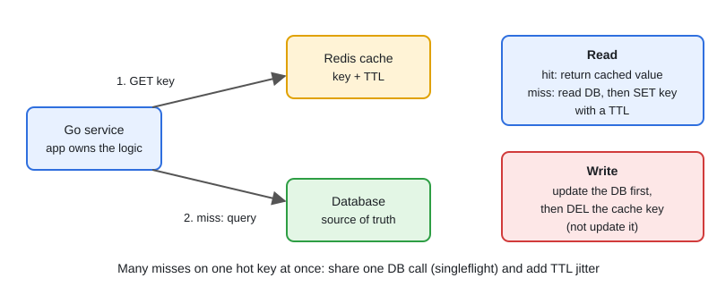

# 04 · Redis Patterns

[← Section index](../README.md) · Prev: [03 · PostgreSQL for Go Developers](../03-postgresql-for-go-developers/README.md) · Next: [05 · Kafka, NATS & GCP Pub/Sub Deep Dive](../05-kafka-nats-pubsub-deep-dive/README.md)

**Interview weight: 1.2%**  ·  Revise in: 8 min  ·  Run: `go run ./07-backend-ecosystem/04-redis-patterns`

## In one line
Redis is a fast in-memory store; the pattern to know is cache-aside with a TTL, plus protection against stampedes.

## Must know
- Data types: string (cache, counter), hash (object), list (queue), set (unique items), sorted set (leaderboard). Every key can have a TTL (`EXPIRE`, `SET ... EX`).
- Each command runs atomically (commands execute one at a time). `INCR` is safe for counters.
- Cache-aside: read cache, on miss read DB and `SET` with TTL. On write, update the DB, then `DEL` the key.
- Lock: `SET key token NX PX 30000`. Release only if the value is still your token (a Lua script does compare-and-delete).
- A Redis lock is "good enough" for efficiency, not a hard safety guarantee. Protect critical data with DB constraints.
- Rate limiter: `INCR key` plus `EXPIRE` for a fixed window.
- Persistence is RDB (snapshots) or AOF (append log), and recent writes can be lost. Memory is finite: set `maxmemory` and an eviction policy.
- Pub/Sub is fire-and-forget (no replay). Use Streams or Kafka when you need durability.

## Diagram


## Code to remember
```go
// requires github.com/redis/go-redis/v9
val, err := rdb.Get(ctx, key).Result()
if errors.Is(err, redis.Nil) { // key missing = cache miss
	val, err = loadFromDB(ctx, key)
	if err != nil { return "", err }
	rdb.Set(ctx, key, val, 5*time.Minute) // always set a TTL
} else if err != nil {
	return "", err // Redis down: decide to fail or fall back to the DB
}
return val, nil
```

## Common traps
- Cache stampede: a hot key expires and many requests hit the DB. Share one load per key (singleflight, as in `main.go`) and add TTL jitter.
- Cache penetration: requests for keys that do not exist always miss. Cache a short-lived "not found".
- Updating the cache on write instead of deleting it can leave stale data after a race.
- Keys with no TTL grow memory until eviction or an out-of-memory error.

## Interview Q&A

**Q1. Why is Redis fast?**

**A:** Data lives in memory, it uses simple data structures, and a single thread runs commands so there is no lock contention.

**Q2. Cache-aside vs write-through, and how do you keep cache and DB consistent?**

**A:** Cache-aside: the app loads on a miss, updates the DB then deletes the key on write, with a TTL as a safety net. Write-through: every write goes to cache and DB together. You cannot be perfect; accept short staleness.

**Q3. Which data type for a leaderboard, a queue, a counter?**

**A:** Sorted set (`ZADD`, `ZRANGE`), list (`LPUSH`/`BRPOP`), string with `INCR`.

**Q4. How would you implement a distributed lock?**

**A:** `SET key token NX PX ttl`, do the work, release with a Lua compare-and-delete. Pick a TTL longer than the work, and know it can still fail on pauses or failover.

**Q5. What is an eviction policy?**

**A:** What Redis removes when memory is full. `allkeys-lru` drops the least recently used key; `volatile-*` only considers keys with a TTL. The default `noeviction` rejects writes when full.

**Q6. RDB vs AOF persistence?**

**A:** RDB takes point-in-time snapshots: compact and fast to restore, but you lose writes since the last one. AOF logs every write (fsync each second by default): safer, bigger and slower to replay. Many setups enable both.

**Q7. What is a cache stampede and how do you stop it?**

**A:** A hot key expires and many requests hit the DB at once. Share one load per key (singleflight or a short lock), add TTL jitter, and refresh hot keys early.
