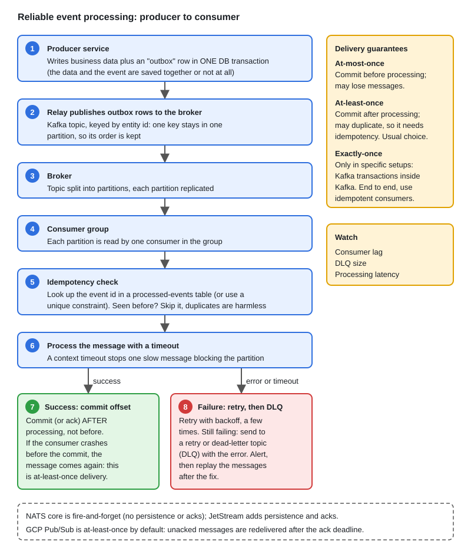

# 05 · Kafka, NATS & GCP Pub/Sub Deep Dive

[← Section index](../README.md) · Prev: [04 · Redis Patterns](../04-redis-patterns/README.md) · Next: [Neo4j & Graph Modeling](../06-neo4j-graph-modeling-cypher/README.md)

**Interview weight: 1.2%**  ·  Revise in: 10 min  ·  Run: `go run ./07-backend-ecosystem/05-kafka-nats-pubsub-deep-dive`

## In one line
Kafka is a partitioned, replicated log: order is kept per partition, consumers in a group share partitions, and delivery is at-least-once so handlers must be idempotent.

## Must know
- Topic is split into partitions. Parallelism and ordering both live at the partition level.
- Same message key goes to the same partition, so one key stays in order. No order across partitions.
- Consumer group (consumers sharing one `GroupID`): each partition is read by one consumer in the group. More consumers than partitions leaves some idle. A rebalance pauses processing briefly.
- Offset = position in a partition. Commit after processing gives at-least-once; commit before gives at-most-once.
- Durability: replication plus producer `acks=all` with `min.insync.replicas`. `acks=1` can lose acknowledged data on leader failure.
- Exactly-once across systems needs an idempotent consumer (dedupe key or unique constraint).
- Watch consumer lag (latest offset minus committed offset). After N failed retries send a poison message to a dead-letter topic.
- NATS core is at-most-once and in-memory (JetStream adds persistence). GCP Pub/Sub is managed, at-least-once, redelivers unacked messages after the ack deadline.

## End-to-end


## Code to remember
```go
// requires github.com/segmentio/kafka-go
r := kafka.NewReader(kafka.ReaderConfig{
	Brokers: []string{"localhost:9092"}, GroupID: "billing", Topic: "orders"})
for {
	m, err := r.FetchMessage(ctx)
	if err != nil { break }
	if err := handle(m); err != nil { sendToDLQ(m) } // handle must be idempotent
	r.CommitMessages(ctx, m) // commit AFTER processing
}
```

## Common traps
- Committing before processing loses messages on a crash.
- Slow processing past the poll timeout makes the broker think the consumer died, causing rebalance loops.
- Too few partitions caps parallelism, and you cannot reduce the count later.
- Assuming global order: Kafka only orders within one partition.

## Interview Q&A

**Q1. How do you keep order for one customer?**

**A:** Use the customer id as the message key. All its messages go to one partition and are read in order.

**Q2. Can Kafka give exactly-once?**

**A:** Inside Kafka, yes, with idempotent producer and transactions. For external side effects, use at-least-once plus an idempotent handler.

**Q3. What happens if a consumer crashes mid-processing?**

**A:** Its partitions move to another consumer, which restarts from the last committed offset, so some messages are processed again.

**Q4. Kafka vs NATS vs GCP Pub/Sub (vs a queue like RabbitMQ)?**

**A:** Kafka: high-throughput replayable log, you run partitions. NATS: very low latency, simple; core is fire-and-forget, JetStream adds persistence. Pub/Sub: managed, no partitions to run, redelivers unacked messages. A classic queue deletes messages after ack and suits task distribution.

**Q5. How do you scale consumers?**

**A:** Add consumers to the group up to the partition count. Beyond that, add partitions.
