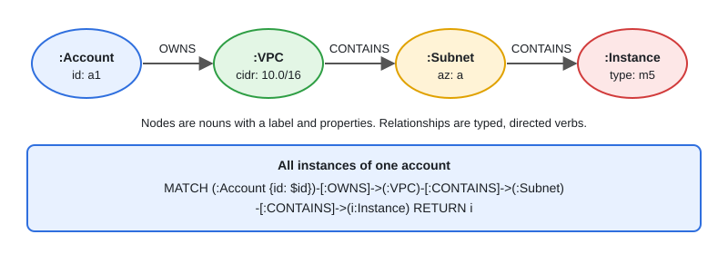

# Neo4j & Graph Modeling

[← Section index](../README.md) · Prev: [05 · Kafka, NATS & GCP Pub/Sub Deep Dive](../05-kafka-nats-pubsub-deep-dive/README.md) · Next: [MongoDB Basics & Schema Design](../07-mongodb-basics-and-schema-design/README.md)

**Interview weight: 1.0%**  ·  Revise in: 5 min  ·  Run: `go run ./07-backend-ecosystem/06-neo4j-graph-modeling-cypher`

## In one line
Neo4j stores data as nodes and relationships, so multi-hop questions like "friends of friends" are traversals instead of expensive JOINs.

## Must know
- Property graph: labeled nodes, typed directed relationships, properties on both. Nouns are nodes, verbs are relationships (see diagram).
- Cypher is pattern matching: `MATCH` finds patterns, `WHERE` filters, `RETURN` projects.
- `CREATE` always inserts. `MERGE` means "find or create", so it is safe to repeat. Back it with a uniqueness constraint.
- Create an index or constraint on the property you start from, or `MATCH` scans every node of that label.
- Use query parameters (`$name`), never string concatenation (injection, and the plan can be cached).
- Good fit: recommendations, fraud rings, dependency or permission graphs, shortest path. Poor fit: plain CRUD and big aggregations.
- Go: official driver `github.com/neo4j/neo4j-go-driver/v5` over Bolt (Neo4j's binary protocol). Use sessions and managed transactions, and close them.

## Diagram


## Code to remember
```cypher
// friends of friends who I do not already follow
MATCH (me:Person {name: $name})-[:FOLLOWS]->()-[:FOLLOWS]->(fof)
WHERE fof <> me AND NOT (me)-[:FOLLOWS]->(fof)
RETURN DISTINCT fof.name
```

## Common traps
- Unbounded variable-length paths (`[:FOLLOWS*]`) can explode. Set a max depth, like `*1..3`.
- Using a graph database just because data has relations. A normal SQL JOIN is fine for one or two hops.

## Interview Q&A

**Q1. Why is graph traversal fast? What is index-free adjacency?**

**A:** Index-free adjacency: each node points directly to its neighbours, so a traversal follows pointers instead of joining tables, and cost depends on the part of the graph touched.

**Q2. Graph vs relational?**

**A:** Relational for structured, tabular data and transactions. Graph when the questions are about connections and many hops (recommendations, fraud, shortest path). Many deployments use both.

**Q3. CREATE vs MERGE?**

**A:** CREATE always adds a new node. MERGE matches an existing one or creates it, which avoids duplicates.

**Q4. How do you keep a Cypher query fast?**

**A:** Index or constrain the property you start from, bound variable-length paths (`*1..3`), use parameters, and check the plan with `PROFILE`.
