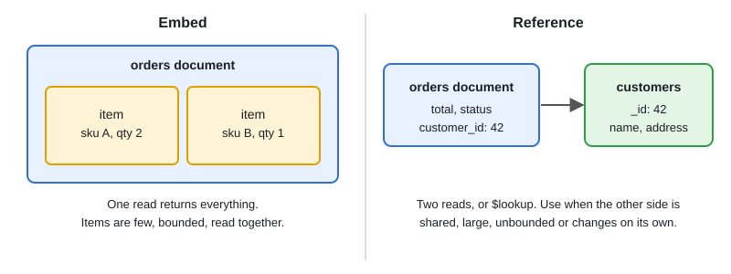

# MongoDB Basics & Schema Design

[← Section index](../README.md) · Prev: [Neo4j & Graph Modeling](../06-neo4j-graph-modeling-cypher/README.md) · Next: [Kubernetes for Go Developers](../08-kubernetes-for-go-developers/README.md)

**Interview weight: 0.8%**  ·  Revise in: 5 min  ·  Run: `go run ./07-backend-ecosystem/07-mongodb-basics-and-schema-design`

## In one line
MongoDB stores JSON-like documents in collections; design the document around how the app reads it, embedding data that is read together.

## Must know
- Document = BSON (binary JSON) object with a unique `_id` (default `ObjectID`). Collection = group of documents, no fixed schema.
- Embed data that is read together and bounded (order with its line items). Reference data that is shared, large or changes on its own (customer). See diagram.
- Model for access patterns, not for normalisation. Duplicating a little data is normal.
- A document has a size limit (16 MB). Do not use arrays that grow without bound.
- Queries: `find`, `updateOne` with operators (`$set`, `$inc`, `$push`), `aggregate` pipelines (stages like `$match`, `$group`, `$lookup` run in order).
- Indexes work like B-tree indexes elsewhere. Add them for your filters and sorts; compound index order matters.
- Single-document writes are atomic. Multi-document transactions exist on replica sets, but needing them often means the model should change.
- Replica set gives high availability. Sharding splits data by a shard key, and a bad key creates hot shards.

## Diagram


## Code to remember
```go
// requires go.mongodb.org/mongo-driver (v1 API shown)
coll := client.Database("shop").Collection("orders")
var o Order
err := coll.FindOne(ctx, bson.M{"status": "paid"}).Decode(&o)
if errors.Is(err, mongo.ErrNoDocuments) {
	// not found
}
```

## Common traps
- Treating it like SQL: many references plus `$lookup` everywhere gives slow, join-like queries.
- Queries without an index scan the whole collection.
- Unbounded embedded arrays (comments inside a post) grow past limits and slow every update.

## Interview Q&A

**Q1. Embed or reference?**

**A:** Embed for one-to-few data read together. Reference for one-to-many large sets or data shared by many parents.

**Q2. When choose MongoDB over PostgreSQL?**

**A:** Flexible or evolving document-shaped data and easy horizontal scale. Choose PostgreSQL for strong relational integrity and complex joins.

**Q3. Replica set vs sharding?**

**A:** A replica set copies the same data to several nodes for failover and read scaling. Sharding splits data across nodes by a shard key to scale writes and size; pick a key with high cardinality and even spread.

**Q4. Is MongoDB ACID?**

**A:** Single-document operations are atomic. Multi-document transactions are supported on replica sets and sharded clusters, with a performance cost.

**Q5. A MongoDB query is slow. What do you do?**

**A:** Run `explain("executionStats")`. A `COLLSCAN` or many documents examined per document returned means a missing or badly ordered index. Add a compound index that matches the filter and sort (equality fields first).
