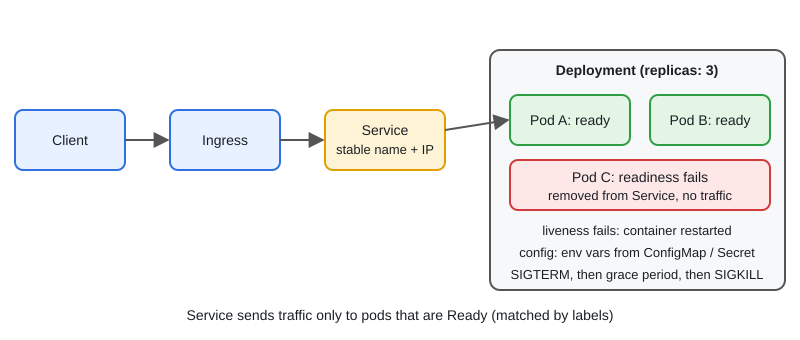

# Kubernetes for Go Developers

[← Section index](../README.md) · Prev: [MongoDB Basics & Schema Design](../07-mongodb-basics-and-schema-design/README.md) · Next: [Observability: Prometheus, Grafana, Logging & Tracing](../09-observability-prometheus-grafana-logging-tracing/README.md)

**Interview weight: 1.0%**  ·  Revise in: 8 min  ·  Run: `go run ./07-backend-ecosystem/08-kubernetes-for-go-developers`

## In one line
Kubernetes runs your container as pods behind a Service; your Go app helps by exposing health endpoints, reading config from env vars and shutting down on SIGTERM.

## Must know
- Pod = smallest unit (one or more containers). Deployment manages replicas and rolling updates. Service (found by label selector) gives a stable name and IP and load-balances to ready pods. Types: ClusterIP (internal, default), NodePort, LoadBalancer.
- Ingress routes external HTTP traffic to Services. ConfigMap and Secret inject config as env vars or files (Secret is base64, not encryption by itself).
- Liveness probe: "restart me if this fails". Readiness probe: "send me traffic only when this passes". Startup probe: for slow starts.
- Keep liveness cheap and independent of the database. Check dependencies in readiness.
- Resources: `requests` (used for scheduling) and `limits`. Exceeding the memory limit gets the container OOMKilled.
- Shutdown: Kubernetes sends SIGTERM, waits `terminationGracePeriodSeconds` (default 30), then SIGKILL. Handle SIGTERM and call `srv.Shutdown`.
- Rolling update replaces pods gradually. HPA (Horizontal Pod Autoscaler) scales replicas on CPU or custom metrics.
- Go 1.25 sets `GOMAXPROCS` from the container CPU limit on Linux. `GOMEMLIMIT` is a soft limit: set it a bit under the memory limit.

## Diagram


## Code to remember
```yaml
readinessProbe:
  httpGet: { path: /readyz, port: 8080 }
  periodSeconds: 5
livenessProbe:
  httpGet: { path: /healthz, port: 8080 }
  initialDelaySeconds: 10
resources:
  requests: { cpu: 100m, memory: 128Mi }
  limits:   { memory: 256Mi }
```

## Common traps
- Ignoring SIGTERM: in-flight requests are cut when the grace period ends.
- Liveness probe that checks the database: a DB outage restarts every pod.
- No readiness probe: traffic reaches a pod before it is ready.
- Logging to files instead of stdout/stderr, so `kubectl logs` shows nothing.

## Interview Q&A

**Q1. Pod vs Deployment vs Service?**

**A:** A pod runs the containers and dies for good. A Deployment keeps N replicas of a pod template and does rolling updates and rollbacks. A Service gives those changing pods one stable address.

**Q2. Liveness vs readiness?**

**A:** Liveness failure restarts the container. Readiness failure only removes the pod from the Service until it recovers.

**Q3. A pod is in CrashLoopBackOff. What do you check?**

**A:** `kubectl logs --previous`, `kubectl describe pod` (exit code, OOMKilled, probe failures), and events. Then config, secrets and dependencies.

**Q4. How do you do zero-downtime deploys?**

**A:** Rolling update, a correct readiness probe, SIGTERM graceful shutdown, and multiple replicas.

**Q5. Why was my Go service OOMKilled?**

**A:** Memory use passed the container limit. Check for leaks and unbounded buffers, and set `GOMEMLIMIT` below the limit so the GC works harder first.

**Q6. How does a rolling update work, and how do you roll back?**

**A:** The Deployment starts new pods and stops old ones in steps (`maxSurge`, `maxUnavailable`), moving on only when new pods are ready. Undo with `kubectl rollout undo`.
