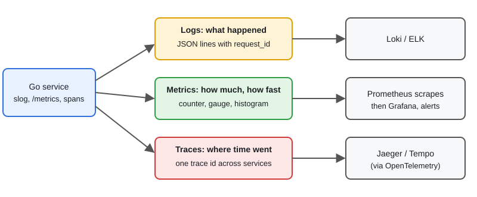

# Observability: Prometheus, Grafana, Logging & Tracing

[← Section index](../README.md) · Prev: [Kubernetes for Go Developers](../08-kubernetes-for-go-developers/README.md) · Next: [Security: mTLS, JWT, OAuth & Istio](../10-security-mtls-jwt-oauth-istio/README.md)

**Interview weight: 1.0%**  ·  Revise in: 7 min  ·  Run: `go run ./07-backend-ecosystem/09-observability-prometheus-grafana-logging-tracing`

## In one line
Observability is logs (what happened), metrics (how much and how fast) and traces (where the time went), tied together by a request or trace id.

## Must know
- Logs: structured (JSON) with `log/slog` (Go 1.21+). Include a request id. Never log secrets or tokens.
- Metrics: Prometheus pulls (scrapes) `/metrics` from your service. Grafana draws dashboards and Alertmanager sends alerts.
- Metric types: counter (only goes up), gauge (up and down), histogram (latency buckets, gives percentiles), summary (client-side quantiles, cannot be aggregated across pods).
- PromQL (Prometheus's query language): `rate(http_requests_total[5m])` is requests per second. p99 latency: `histogram_quantile(0.99, sum by (le) (rate(http_request_duration_seconds_bucket[5m])))`. Use a histogram, not an average.
- RED for services: Rate, Errors, Duration. USE for resources: Utilization, Saturation, Errors.
- Labels multiply series. Never label with user id, request id or raw URL paths (cardinality explosion).
- Tracing: a trace is a tree of spans across services. The trace id travels in the `traceparent` header (W3C). OpenTelemetry is the standard SDK.
- Alert on symptoms users feel (error rate, latency), not on every CPU spike.

## Diagram


## Code to remember
```go
// requires github.com/prometheus/client_golang
var reqs = promauto.NewCounterVec(prometheus.CounterOpts{
	Name: "http_requests_total", Help: "Requests by status code"}, []string{"code"})

reqs.WithLabelValues("200").Inc()
http.Handle("/metrics", promhttp.Handler())

slog.Info("handled", "request_id", id, "code", 200) // stdlib structured log
```

## Common traps
- High-cardinality labels make Prometheus run out of memory.
- Averages hide tail latency. Look at p95 and p99.
- Logs without a request id cannot be followed across services.
- Not propagating the context, so traces break at service boundaries.

## Interview Q&A

**Q1. Logs vs metrics vs traces?**

**A:** Metrics tell you something is wrong, traces show which service or call is slow, logs give the detail of what happened.

**Q2. When would you use a counter, a gauge, a histogram?**

**A:** Counter for totals (requests, errors), gauge for current values (queue depth, goroutines), histogram for latency or sizes so you can compute percentiles.

**Q3. Why does Prometheus pull instead of push?**

**A:** The server controls scrape rate and can tell when a target is down. Short-lived jobs use a push gateway.

**Q4. How do you find why one request was slow?**

**A:** Find its trace by trace id, see which span took the time, then read the logs for that span using the same id.

**Q5. What would you alert on?**

**A:** Error rate and latency (p99) against an SLO (service level objective, the target), plus saturation like queue depth. Alerts should be actionable.
