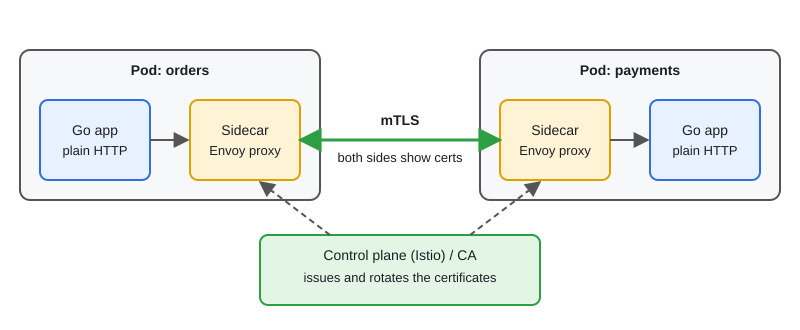
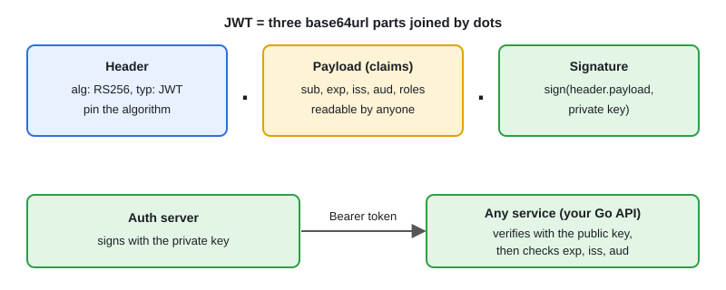

# Security: mTLS, JWT, OAuth & Istio

[← Section index](../README.md) · Prev: [Observability: Prometheus, Grafana, Logging & Tracing](../09-observability-prometheus-grafana-logging-tracing/README.md) · Next: [Docker & CI/CD for Go](../11-docker-ci-cd-for-go/README.md)

**Interview weight: 1.0%**  ·  Revise in: 8 min  ·  Run: `go run ./07-backend-ecosystem/10-security-mtls-jwt-oauth-istio`

## In one line
Authenticate users with tokens (OAuth2/OIDC and JWT), authenticate services to each other with mTLS (mutual TLS: both sides show certificates), and let a service mesh like Istio do the mTLS for you.

## Must know
- TLS: the client checks the server certificate. mTLS: both sides present certificates, so the server also knows who the client is.
- JWT = `header.payload.signature`, base64url encoded (see JWT diagram). It is signed, not encrypted: anyone can read the payload, so keep secrets out.
- HS256 uses one shared secret. RS256 uses a private key to sign and a public key to verify (better across services).
- Verify the signature, `exp`, `iss` and `aud`. Pin the expected algorithm and reject `alg: none`.
- Short-lived access token plus a refresh token. A JWT cannot be revoked before expiry unless you keep a denylist.
- OAuth2 is delegated authorization; OIDC adds identity (the id token). Flows: authorization code with PKCE (a one-time secret that stops code theft) for users, client credentials for services.
- Istio: a sidecar proxy next to each pod handles mTLS, so apps speak plain HTTP locally. Policies: `PeerAuthentication` (mTLS mode) and `AuthorizationPolicy` (who may call what).
- Hash passwords with bcrypt or argon2. Compare secrets with `hmac.Equal` or `subtle.ConstantTimeCompare`. Keep secrets out of code and images.

## Diagram




## Code to remember
```go
// stdlib mTLS server: require and verify a client certificate
cfg := &tls.Config{
	MinVersion: tls.VersionTLS12,
	ClientAuth: tls.RequireAndVerifyClientCert,
	ClientCAs:  caPool, // CAs allowed to sign client certs
}
srv := &http.Server{Addr: ":8443", TLSConfig: cfg}
log.Fatal(srv.ListenAndServeTLS("server.crt", "server.key"))
```

## Common traps
- Trusting the `alg` field in the token header.
- Putting sensitive data in a JWT payload, or logging full tokens.
- Long-lived access tokens with no way to revoke them.
- Mixing up 401 (not authenticated) and 403 (not authorized).

## Interview Q&A

**Q1. TLS vs mTLS?**

**A:** TLS proves the server to the client. mTLS proves both directions, which suits service-to-service traffic.

**Q2. JWT vs server-side session?**

**A:** Session: the server stores state and the client holds an id in a cookie. Easy to revoke, but needs a shared store. JWT: self-contained and stateless, so any service can verify it, but hard to revoke (use short expiry plus refresh). Validate it in middleware on every request.

**Q3. OAuth2 vs OIDC?**

**A:** OAuth2 grants access to resources (authorization). OIDC is a layer on OAuth2 that tells the app who the user is (authentication).

**Q4. What does Istio add for security?**

**A:** Automatic mTLS between pods through sidecars, certificate rotation, and policies about which service may call which.

**Q5. What do you check when validating a JWT?**

**A:** The signature with the expected algorithm and key, then `exp`, `iss` and `aud`. Reject `alg: none` and never trust the algorithm named in the token header.
