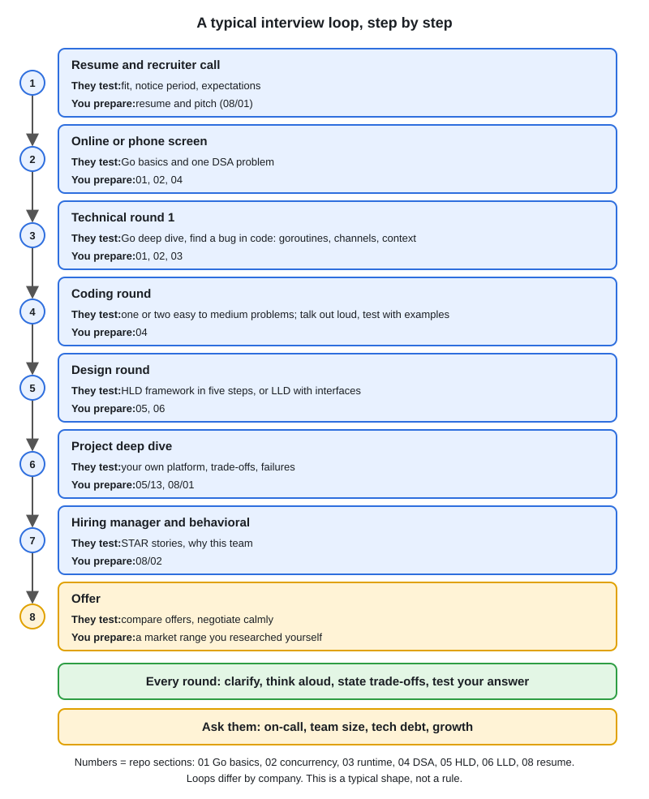

# Interview Rounds and Questions to Ask

[← Section index](../README.md) · Prev: [STAR Stories](../02-star-stories/README.md) · Next: [Rapid-Fire Question Bank](../04-rapid-fire-question-bank/README.md)

**Interview weight: 0.6%**  ·  Revise in: 5 min

## In one line
Know what each round tests, and always have two or three good questions ready for the end.

## End-to-end

## Must know
- Rounds vary by company. A typical mid-level Go loop is below.
- Talk while you code or design. Silence hides your reasoning.
- Ask clarifying questions first, then state your approach before writing code.

| Round | Focus | Prep folder |
|---|---|---|
| Recruiter screen | Background, notice period, expectations | 01 resume, Q&A below |
| Technical screen | Go concepts, concurrency, one easy problem | 01, 02, 03 |
| Coding (DSA) | One or two medium problems, complexity | 04-dsa |
| System design (HLD) | Design a service, trade-offs | 05-system-design-hld |
| LLD | Entities, interfaces, a small design | 06-lld-design-patterns |
| Behavioral / manager | STAR stories, team fit | 02 stories |

## Questions to ask
- What does a typical week look like for this team, and what is the on-call setup?
- What is the biggest technical challenge for the team in the next six months?
- How do you handle technical debt and code review?
- What does a good first 90 days look like?

## Common traps
- Having no questions. It reads as low interest.
- Asking only about salary or leave in a technical round. Raise it with the recruiter or HR.

## Interview Q&A

**Q1. Do you have any questions for us?**

**A:** Yes. Ask two or three from the list above, tied to what you heard in the interview.

**Q2. What is your notice period and expected salary?**

**A:** Notice: your real [N days]; say it is negotiable only if you have checked. Salary: ask for the budget range first; if pressed, give a range from your market research, and never misstate current pay.

**Q3. Why do you want to join this company?**

**A:** Research the product and tech stack beforehand and link them to what you want to grow in. Avoid generic praise or pay as the reason.

**Q4. Where do you see yourself in three years?**

**A:** Show growth in technical depth and ownership (design, mentoring) that this role can support. Avoid vague titles or hinting you will leave.
